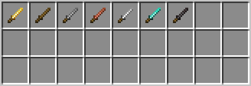
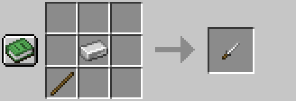
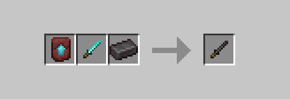

# DaggerCrafting

[LICENSE](LICENSE.md)

[GITHUB](https://github.com/JakobPCoder/Minecraft-DaggerCrafting)

This is an early version, feedback and ideas are welcome!

DaggerCrafting is a Minecraft mod that introduces throwable daggers as a new weapon type, blending fast-paced melee and ranged combat. Each dagger's stats and behavior are determined by its material, offering new strategic options. Also its a lot of fun!

### Blended Combat: Redefining Your Playstyle

DaggerCrafting transcends traditional weapon types, offering a unique blended combat experience. Engage enemies up close with rapid melee strikes, then seamlessly transition to ranged assaults by precisely throwing your dagger. This dual functionality encourages dynamic combat strategies, allowing you to adapt on the fly whether clearing crowds or picking off distant foes.

## Daggers

Daggers are crafted using a stick and a piece of the corresponding material, placed diagonally in a crafting grid.

Netherite Daggers are obtained just like other netherite items.

## Ranged Combat

When holding and releasing the right mouse button, the dagger will be thrown, similar to tridents.

*   The **damage** the dagger deals on impact and the **speed** with which the dagger is thrown are based on the dagger's material.
*   The dagger is thrown with a **speed** based on the **material**, its **throwing speed enchantment** and the **draw/charge time**.
*   The **knockback**: Knockback is essential for repeated attacks with a dagger, so _Creepers_ etc. are kept at range. The force of a dagger's **knockback** is directly proportional to its **velocity** when it hits a target. This means daggers thrown with greater initial speed will send enemies flying further!

## Melee Combat

When in the main hand, the dagger will work just like a sword, but with less damage, a faster attack speed, and a slightly shorter reach.

A dagger is a close-quarters weapon, so it keeps sword mining parity but swings at 80% of the distance a sword does:

| | Swing reach (survival) | Swing reach (creative) |
| --- | --- | --- |
| Sword and other vanilla weapons | 3.0 blocks | 5.0 blocks |
| Dagger | 2.4 blocks (80%) | 4.0 blocks (80%) |

Only the distance at which a swing connects is shorter. Block breaking and entity interaction distance are unchanged, so chests, levers, trading and mounts behave exactly as they do with a sword. A connecting swing costs 1 durability.

Daggers mine the same blocks as swords. Cobwebs drop the item, bamboo breaks instantly, and sword-efficient plants break faster: leaves, vines, glow lichen, pumpkins, melons, cocoa, big dripleaf, and chorus. A block that has hardness costs 2 durability. Instant blocks such as bamboo do not.

## Enchantments

Daggers support the following enchantments:

### Custom enchantments

*   **Throwing Speed** (Levels I-III)
    *   Each level raises the dagger's throw speed, so it travels further and knocks the target back harder. Offered by the enchanting table, exploration loot, and librarian trades.
*   **Restitution** (Level I)
    *   On a thrown hit against an entity, including a fully blocked hit, the dagger is put back in the thrower's inventory immediately. Misses and block-only landings do not return. Cannot be combined with Loyalty. Same sources as Throwing Speed.

### Vanilla, from the enchanting table

*   **Loyalty** (Levels I-III)
    *   The return speed scales with the material's base throw velocity, so a diamond or netherite dagger comes back faster than a wooden one.
*   **Fire Aspect** (Levels I-II)
    *   Melee only. Sets the target on fire: **I** for 4 seconds, **II** for 8 seconds.
*   **Flame** (Level I)
    *   Thrown attacks only. Sets the dagger on fire; a hit sets the target on fire for 4 seconds, which is shorter than a flame arrow (5 seconds).
*   **Unbreaking** (Levels I-III)
*   **Sharpness** (Levels I-V)
    *   Extra damage on melee and thrown hits.
*   **Smite** (Levels I-V)
    *   Extra damage to undead on melee and thrown hits.
*   **Bane of Arthropods** (Levels I-V)
    *   Extra damage to arthropods on melee and thrown hits, and it slows them.

### Vanilla, anvil only

*   **Mending** (Level I)
    *   Not offered by the enchanting table. XP orbs repair the dagger only while it is in the main hand or offhand. A dagger in the inventory, or one currently in the air, does not mend.

Sweeping Edge, Knockback, and Looting are not supported. Daggers are not in the sword item tag, so sword-only enchantments stay off them. Trident and bow enchantments other than Loyalty and Flame are not supported either.

## Stats

| **Material** | **Ranged Damage** | **Ranged Velocity** | **Durability** | **Melee Damage** | **Enchantability** |
| -------- |------------- |--------------- |---------- |------------- |-------------- |
| Golden |4 |**1.7** |20 |2 |**25** |
| Wooden |4 |1.5 |30 |2 |15 |
| Stone |5 |1.6 |50 |3 |14 |
| Copper |6 |1.7 |70 |3 |13 |
| Iron |7 |1.8 |100 |4 |11 |
| Diamond |8 |**2.0** |250 |5 |10 |
| Netherite |9 |**2.0** |500 |6 |15 |

---
